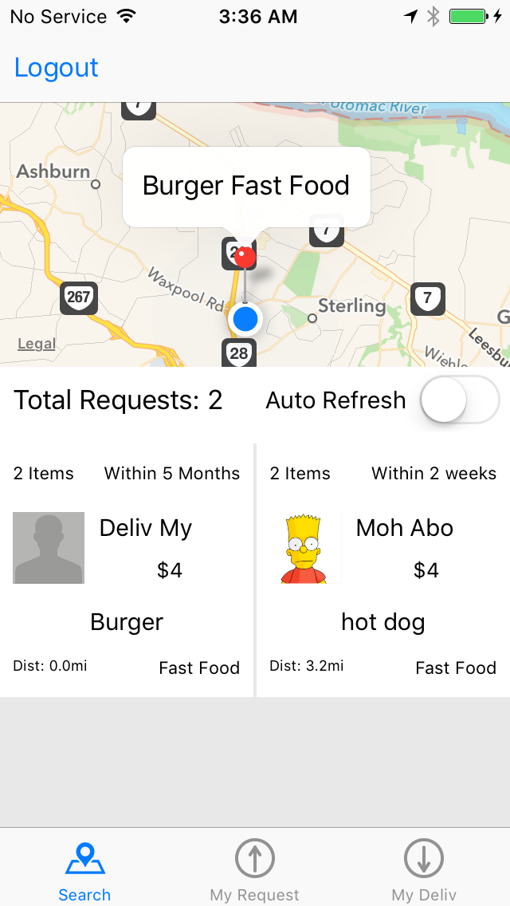
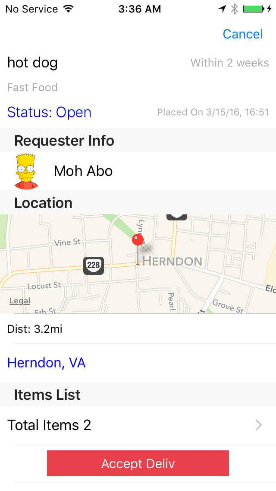
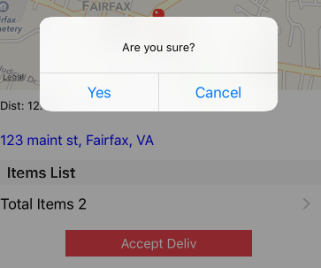
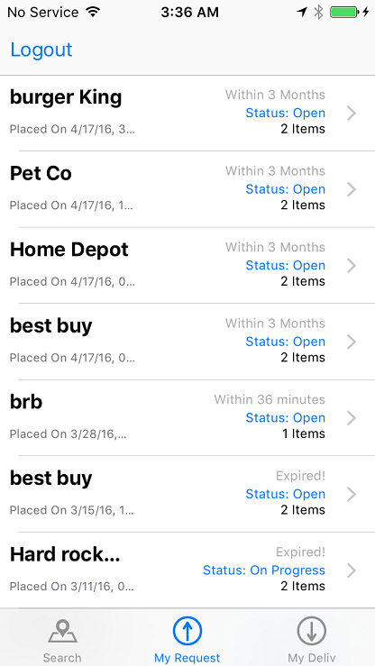
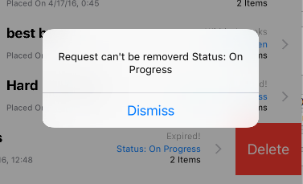
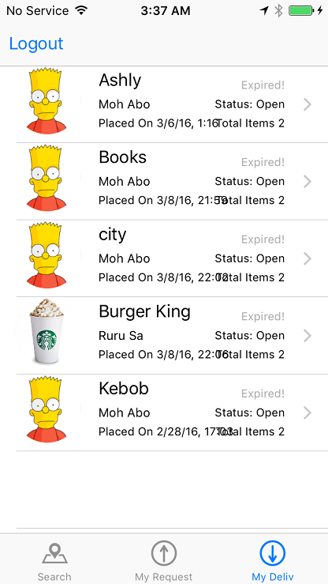

# DelivMyApp

DelivMy connects people placing local delivery requests with nearby couriers. The iOS app supports:

- Signing in and opening the signup page.
- Searching the map for available requests, displaying nearby results, and optionally refreshing every 15 seconds while that screen is active.
- Viewing request information, items, and location; accepting a delivery after confirmation.
- Viewing your requests and deleting an open request after confirmation.
- Viewing accepted deliveries and available courier/requester details and receipt images.

Request creation, receipt upload, and completion aren't available in the iOS app. Requests and deliveries are stored on the server, not in a local Core Data cache.

## Build and run

- **Xcode 27.2 / Swift 6.4.2**, building against **iOS 27.2**. iOS and iPadOS **17 or later** are supported.
- Open `DelivMyApp.xcodeproj`, choose the shared **DelivMyApp** scheme and an iPhone simulator, and Run.
- A physical device requires configuring your signing team. The existing `com.DelivMyApp` bundle identifier is unchanged.
- The API client is in the local Swift package `DelivMyCore`. No external Swift dependencies are required.
- The Release app accepts only HTTPS. Its default API URL is `https://delivmy.com/`, which must serve the matching upgraded [DelivMy-Rails](https://github.com/moh1221/DelivMy-Rails) API. Set the `DELIVMY_API_BASE_URL` Xcode build setting to override that URL for an HTTPS staging or production build. The default hostname was preserved, not deployed or verified as live.
- For a **Debug** simulator build, add the `DELIVMY_API_BASE_URL` environment variable in **Edit Scheme → Run → Arguments**. Use `http://localhost:3000` for a development Rails server bound to loopback on the Mac. Debug HTTP is limited in code to loopback addresses; the Release bundle has no ATS exceptions.
- When adapting the existing site, use the exact HTTPS API origin: the client rejects HTTP redirects and authenticates with a bearer token issued by the upgraded Rails login endpoint. The token stays in memory, so relaunching the app requires signing in again. Same-origin app media is loaded without attaching that token.

## Verification

Run `swift test` on a current Swift toolchain. Tests validate the JSON request and response formats, authorization header and endpoint contracts, error handling, and strict URL policy without accessing a live service. GitHub Actions additionally builds the Xcode project and launches it in an iPhone simulator.

To test against the real upgraded backend, start the Rails branch locally, supply a disposable development account, and run:

```sh
export DELIVMY_TEST_BASE_URL=http://localhost:3000
export DELIVMY_TEST_EMAIL='your-local-test-account@example.test'
read -rs DELIVMY_TEST_PASSWORD
export DELIVMY_TEST_PASSWORD
swift test --filter localRailsContract
unset DELIVMY_TEST_PASSWORD
```

The optional integration test is skipped unless all three values are provided. It refuses non-loopback hosts. It signs in, reads your requests and deliveries, searches nearby, reads sample details when present, signs out, and checks that the old token is invalid.

For an end-to-end simulator check, sign in with two disposable accounts in a seeded development environment. As a courier, search near a seeded open request, inspect it, accept it, and verify it moves to **My Deliveries**. As the requester, verify the accepted request is no longer deletable, and verify deletion of a separate open request. Test denied location permission, pull-to-refresh, and signing out.

## Historical screenshots

The screenshots below are from the earlier UIKit version and document the intended workflows. The current SwiftUI interface looks different.

### Nearby requests



### Accept a delivery




### My requests




### My deliveries


